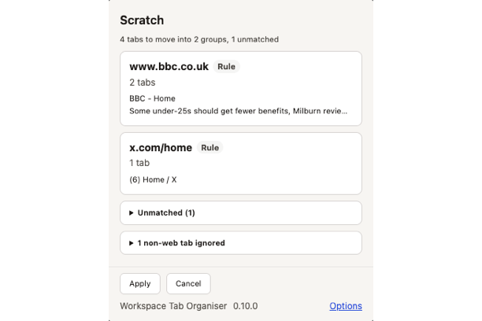

# Workspace Tab Organiser

Workspace Tab Organiser groups the tabs in your current workspace by your own site rules, and previews every move before it happens.

It is an Opera extension.

I built this because I keep the same sites open and I want those tabs together without dragging them.

Rules are a hostname and a path prefix, tried from top to bottom. The first match wins. Tabs that match none of the rules can still form a group when at least two tabs in the workspace share a hostname and the first part of the path. A single leftover tab stays where it is, sorted by its title.

The popup works on the current workspace only. Other workspaces are not listed and are not moved. You see the proposed groups first. Nothing moves until you press Apply. From the popup you can also add a rule for an unmatched tab, or for an automatic group, and the preview refreshes. The Options page is where the full list lives: add a rule from a URL, drag a row to change the order, and save. Saving stores the list on this computer.



## Install

The Opera add-ons listing is coming soon. The link will go here after the extension is approved.

To load it while developing, open `opera://extensions`, turn on Developer mode, and choose Load unpacked. Select the `extension` directory in this repository. After later edits, use Reload on that page.

## How to use it

1. Open the Options page. Add rules from the sites you want grouped, then save.
2. Open the toolbar popup in the workspace you want to tidy.
3. Read the preview. It names the groups and the tabs that would move.
4. Press Apply. Cancel closes the popup and leaves the tabs where they are.

## Privacy and permissions

`storage` saves the rules and the automatic-groups setting on this computer.

`tabs` reads tab addresses and titles in the current window, and moves tabs when you press Apply.

Nothing leaves the browser. There is no analytics and no remote code.

## Limitations

The package is Manifest V2 and asks for Opera 139 or newer. It organises the current workspace only. It does not create native tab groups, and it does not move tabs between workspaces.

## Development

Node.js 20 or newer. There are no npm dependencies.

```bash
npm test
npm run check
npm run package
npm run screenshots
```

`npm test` runs Node's built-in test runner. `npm run check` checks the syntax of the extension, script and test files. `npm run package` writes `dist/workspace-tab-organiser-<version>.zip` with the manifest at the root of the zip. `extension/dev` is left out of that zip. `npm run screenshots` needs macOS `sips`. On any other system it prints a message and exits non-zero.

| Path | What it does |
| --- | --- |
| `extension/popup.js` | Popup: preview, Add rule, Apply |
| `extension/options.js` | Options page for the rule list |
| `extension/matching.js` | First matching hostname and path rule |
| `extension/auto-group.js` | Groups for unmatched tabs that share a site |
| `extension/arrangement.js` | Order of the groups and tabs, without moving them |
| `extension/preview.js` | Preview for the current workspace |
| `extension/apply.js` | Moves tabs after Apply |
| `extension/rule-store.js` | Saves rules with `chrome.storage.local` |
| `scripts/package.js` | Builds the store zip |
| `scripts/screenshots.js` | Pads captures to 612 by 408 on macOS |

- [System design](docs/spec/opera-tab-organiser-system-design.md)
- [Delivery backlog](docs/spec/delivery-backlog.md)
- [Store listing](docs/store/listing.md)
- [Screenshot checklist](docs/store/screenshots.md)
- [Module notes](docs/development.md)
- [Manual checks](docs/testing/manual-checks.md)
- [Manifest version notes](docs/spec/research/manifest-version.md)

## Licence

MIT. See [LICENSE](LICENSE).
