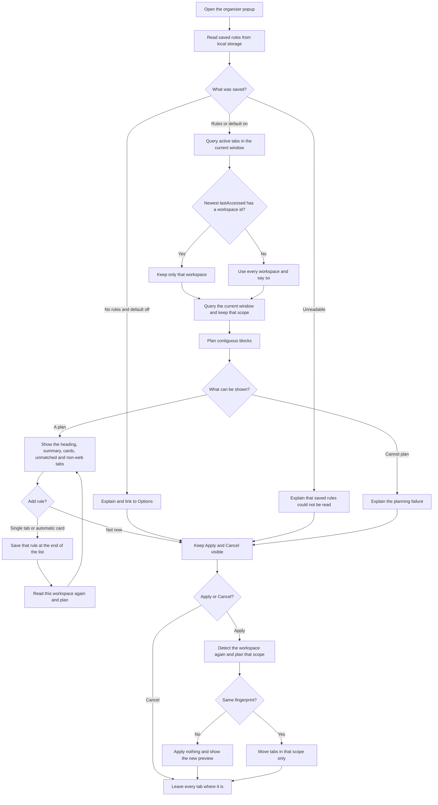
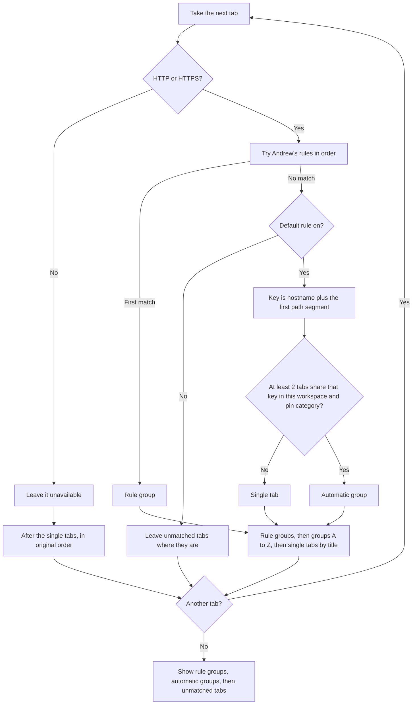
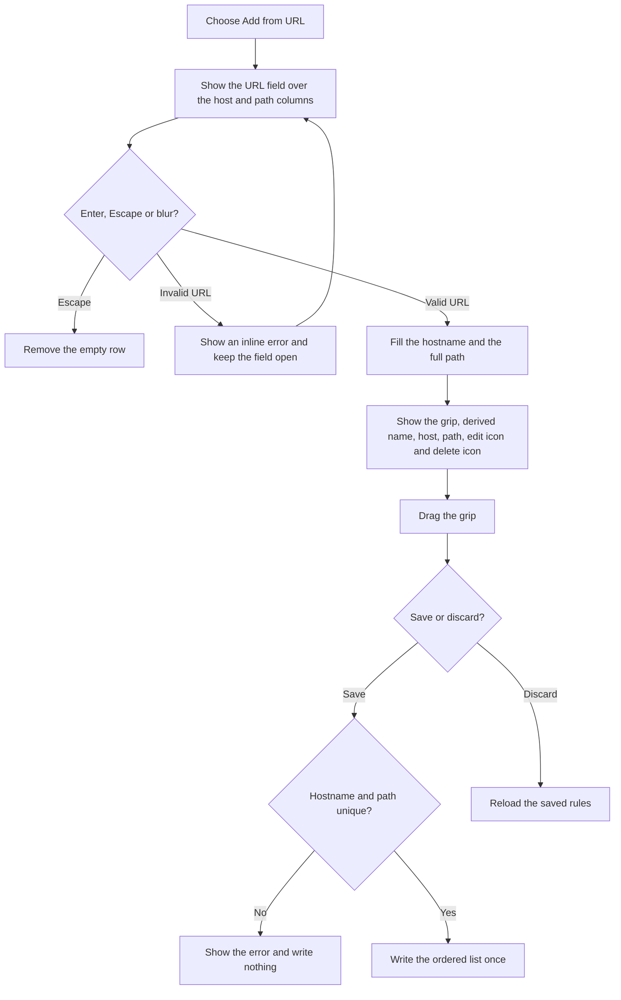
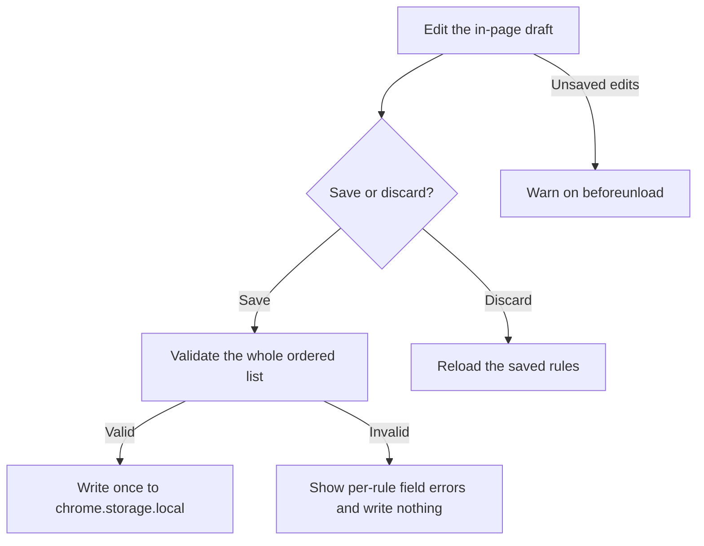
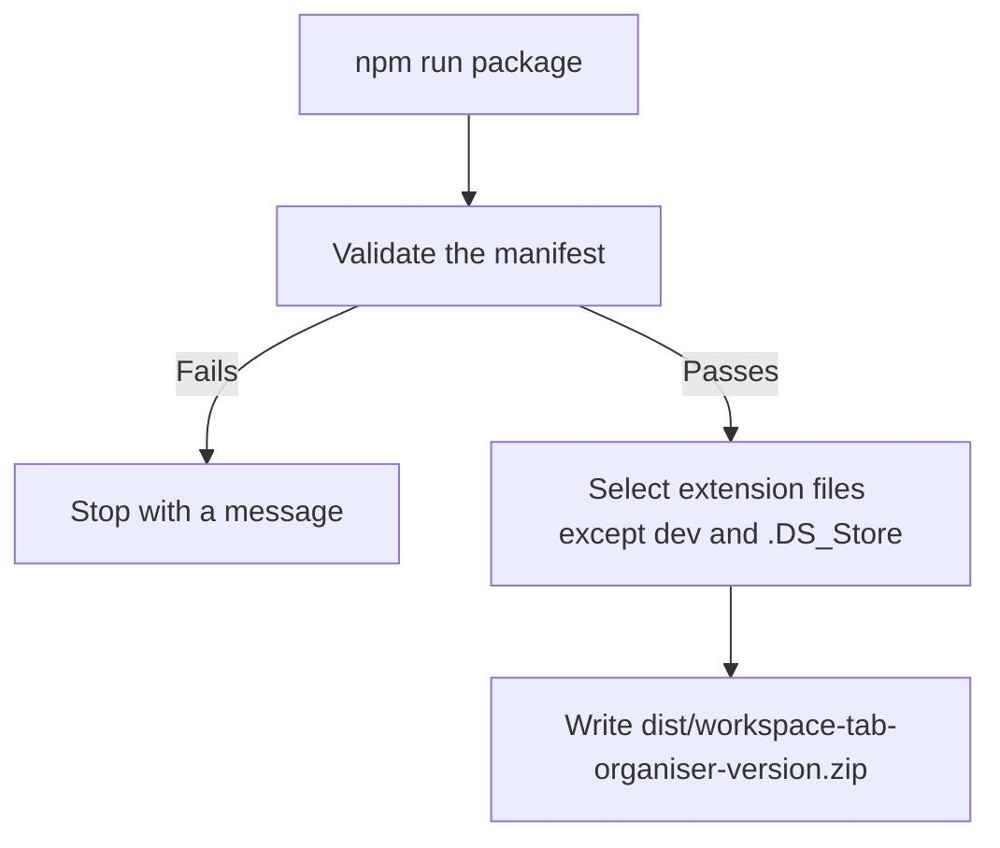

# Workspace Tab Organiser System Design

Status: **DRAFT**

## Contents

- [Context And Purpose](#context-and-purpose)
- [Business Value](#business-value)
- [Definitions](#definitions)
- [Actors In Scope](#actors-in-scope)
- [Current Constraints](#current-constraints)
- [High Level Design](#high-level-design)
- [Detailed Design](#detailed-design)
- [Requirements](#requirements)
- [Validation Strategy](#validation-strategy)
- [Store Packaging](#store-packaging)
- [Risks And Tradeoffs](#risks-and-tradeoffs)
- [Open Questions](#open-questions)
- [Decisions](#decisions)
- [Platform References](#platform-references)
- [Change History](#change-history)

## Context And Purpose

Andrew Pearce has a number of recurring sites and URL paths whose tabs should be easy to find together. This specification defines a local Opera extension that organises those tabs using an ordered set of user-managed rules. It is intended for Andrew's own development and browser use.

The first version will organise matching tabs into contiguous blocks within their current Opera window and workspace. An explicit preview will be displayed before any tab is moved. This specification does not define a public distribution service, account system, remote service or synchronisation service. Version 0.10.0 can be packed for the Opera add-ons catalogue. That package is described in [Store Packaging](#store-packaging). The extension still does not run a service of its own.

Opera documents tab workspace identifiers and names as readable properties. However, it does not document an extension API for moving tabs between workspaces or a Chrome-compatible tab-grouping API. Therefore, automatic workspace assignment and native tab groups are outside this version.

## Business Value

The extension will reduce the manual effort of locating and arranging related tabs. It will make rule behaviour predictable through ordered matching, a preview and a result summary. It will avoid unexpected browser-wide changes by restricting each operation to the current window.

Local-only configuration will keep the implementation small and avoid transmitting browsing data to another service. The main limitation is that Opera workspaces cannot be used as automatic destinations in the documented extension platform.

## Definitions

| Term | Description |
| --- | --- |
| **Organiser Rule** | An ordered configuration entry containing a stable identifier, display label, hostname and optional path prefix. |
| **Matching Tab** | An HTTP or HTTPS tab whose hostname and path match an Organiser Rule. |
| **Contiguous Block** | A sequence of matching tabs that share a display label, a window, an existing workspace, and a pinned or unpinned category. The sequence is contiguous in that workspace and category. Another workspace may still occupy a window index between those tabs. |
| **Preview** | A read-only description of proposed Contiguous Blocks, unmatched tabs and validation problems. |
| **Current Window** | The Opera window from which Andrew opens the organiser. |
| **Workspace Metadata** | The read-only `workspaceId` and `workspaceName` properties exposed by Opera for a tab. |

## Actors In Scope

| Actor | Type | Role |
| --- | --- | --- |
| Andrew | User | Creates and orders Organiser Rules, reviews a Preview and applies or cancels it. |
| Options Page | Extension component | Edits, validates, orders and locally saves Organiser Rules. |
| Organiser Popup | Extension component | Displays a Preview, receives confirmation and reports the result. |
| Matching Engine | Extension component | Selects the first matching Organiser Rule for each tab. |
| Tab Organiser | Extension component | Applies the approved arrangement without navigating, creating or closing tabs. |
| Opera Browser | Browser | Supplies tabs and Workspace Metadata and performs supported tab moves. |
| Local Rule Store | Browser storage | Persists Organiser Rules on this browser installation. |

## Current Constraints

The design uses Opera's documented `chrome.tabs`, `chrome.storage` and `chrome.windows` support rather than assuming Chrome feature parity. The documented manifest uses version 2. Local extension storage is available, but Opera's documentation excludes synchronised and managed storage.

Opera exposes `workspaceId` and `workspaceName` on tabs from Opera 77 onwards. The supported API list contains no workspace-writing API and no `tabGroups` API. Consequently, the extension may describe a tab's existing workspace but will not change it. The initial implementation will use Manifest V2 and `options_page`. Manifest V3 remains unplanned until its Opera support is verified.

The relevant platform facts are recorded in [Platform References](#platform-references). Unsupported or undocumented behaviour will not be inferred from equivalent Chrome features.

## High Level Design

The diagram below shows the user-controlled configuration, preview and application flow. All browser data remains inside the local extension.


```txt
flowchart LR
    Actor[Andrew] -->|Configure ordered rules| Options[Options page]
    Options -->|Save locally| Storage[Local extension storage]
    Actor -->|Open organiser| Preview[Preview]
    Actor -->|Add rule from an unmatched tab| Preview
    Preview -->|Save the new rule| Storage
    Preview -->|Read current window| Tabs[Opera tabs]
    Preview -->|Read ordered rules| Storage
    Preview -->|Show proposed clusters| Actor
    Actor -->|Apply preview| Organiser[Tab organiser]
    Organiser -->|Move within current window and workspace| Tabs
    Organiser -->|Report result| Actor
    Note[Read-only workspace metadata. No workspace assignment or Chrome tab groups.]
    Organiser -.-> Note
```

Andrew first enters Organiser Rules through the Options Page. The Organiser Popup reads those rules and the current window's tabs when opened. The Matching Engine then prepares a Preview without modifying browser state. Add rule can also write one rule from the popup. Only Andrew's confirmation invokes the Tab Organiser. No tab moves until Apply.

### Organisation Flow

The diagram below shows the separation between reading tab information and applying an approved Preview.


```txt
flowchart TD
    Start[Open organiser] --> Read[Read current window tabs and ordered rules]
    Read --> Match[Match each HTTP or HTTPS tab to its first matching rule]
    Match --> Default{Default rule on?}
    Default -->|No| Keep[Group matching tabs and leave unmatched tabs where they are]
    Default -->|Yes| Catch[Group unmatched keys held by at least 2 tabs]
    Catch --> Order[Order rule groups, automatic groups A to Z, then single tabs by title]
    Keep --> Preview[Present preview without moving tabs]
    Order --> Preview
    Preview --> AddRule{Add rule?}
    AddRule -->|Yes| StoreRule[Save the rule and plan again]
    StoreRule --> Preview
    AddRule -->|No| Decision{Apply?}
    Decision -->|No| End[Leave tabs unchanged]
    Decision -->|Yes| Recheck[Re-read tabs and rules and plan again]
    Recheck --> Same{Same target order, pins and active tabs?}
    Same -->|No| Refresh[Apply nothing and show the new preview]
    Same -->|Yes| Move[Move each changed unpinned suffix to the workspace end]
    Move --> Verify[Re-query and record mismatches as failures]
    Verify --> Active[Restore a workspace active tab only if it changed]
    Active --> Report[Report moved, unchanged, unmatched and failed tabs]
    Report --> End
    Refresh --> End
```

Cancellation or an empty Preview leaves every tab unchanged. The result distinguishes moved tabs, already positioned tabs, unmatched tabs and failed moves. A failed move does not produce a claim that the complete arrangement succeeded.

## Detailed Design

### Organiser Rules

Each rule has a generated stable identifier, a non-empty display label, a hostname and an optional path prefix. The Options Page displays rules in matching priority order and allows them to be reordered, edited and removed. The identifier preserves rule identity when its label or match fields change.

Hostnames are normalised to lower case and compared exactly. A rule for `example.com` does not implicitly include `www.example.com`. Path prefixes begin with `/` and are compared case-sensitively against the URL path. Query strings and fragments do not take part in matching. Only HTTP and HTTPS URLs are eligible.

The first Organiser Rule that matches a tab is its only selected rule, as decided in D2. For example, when `docs.example.com/product` appears before `docs.example.com`, the first rule wins. Reversing their displayed order makes the broader hostname rule win.

| Rule order | Hostname | Path prefix | Label |
| --- | --- | --- | --- |
| 1 | `docs.example.com` | `/product` | Product documentation |
| 2 | `docs.example.com` | None | Other documentation |

### Preview And Confirmation

Opening the Organiser Popup creates a new Preview from current tab data. No tab moves occur during popup opening, rule editing or preview generation. D20 limits that Preview, and Apply, to the current workspace. Tabs in other workspaces are neither listed nor moved.

D21 detects the current workspace from `chrome.tabs.query({ active: true, currentWindow: true })`. Opera returns 1 active tab per workspace. The current workspace is the `workspaceId` of the tab with the newest `lastAccessed`. A highlight flag and the last focused window are not used. The popup heading is that tab's `workspaceName`. A blank name is shown as `Workspace unavailable`. When several active tabs share the newest `lastAccessed`, the first one in the query result is kept. A tab with no finite `lastAccessed` is not a candidate. If no candidate exists, or the newest tab has no workspace id, the heading is `This window` and the popup says that the current workspace could not be detected, so the preview includes every workspace. Apply detects the workspace again, so the D8 re-plan uses that same scope. A change in another workspace is outside the fingerprint. A different detected workspace does not match, and nothing is moved.

The first line is a summary, for example `4 tabs to move into 2 groups, 3 unmatched`. The tab count is every unpinned tab whose planned position differs, including a single tab the sort moves and a rejected tab placed after that tail. It also includes a pinned tab that belongs to a group and would move. A pinned single tab is not included. The group count is the blocks that contain at least 1 of those tabs. A group that is already in place is not included. The unmatched count is eligible tabs that stay unmatched. Zero uses the plural. An automatic group is included in that summary, so the popup does not say that no tabs match the saved rules when those groups exist. After a successful unpinned Apply, the report's moved count matches this tab count. The `-1` call list can be longer, because a tab that is sent to the end and lands in the same slot is reported as already in place.

Each group is a card: the name, a `Rule` or `Automatic` tag, the tab count, and the titles. A pinned block also shows a `Pinned` tag. Titles stay on 1 line, with the full title as the tooltip. When the preview covers 1 workspace, the cards do not repeat its name. When detection falls back to the whole window, each card shows the workspace name. Unmatched tabs sit under a collapsed heading `Unmatched (3)`. Non-web tabs, such as Speed Dial, Extensions and the Options page, collapse into 1 line such as `6 non-web tabs ignored`. A tab with no URL is separate, for example `1 tab with no address`. An empty title is `Untitled tab`.

Andrew confirmed D26, D27 and D28 on 11 November 2026. Add rule saves a rule at once, with no confirm step, and then refreshes the preview. It does not Apply. The new rule is appended at the end of the saved list, so an earlier broader rule still wins. The match is the hostname plus the first path segment, the same key as an automatic group. `https://spicymango.atlassian.net/browse/GAM-5363` becomes hostname `spicymango.atlassian.net` and path prefix `/browse`, with the derived name `spicymango.atlassian.net/browse`. A path that is only `/` is no path prefix, so the name is the hostname alone. The scheme, port, query and fragment are dropped. `www.` is kept. The hostname is lower case and the path segment keeps its case. The rule is validated with the same model as a rule saved on the Options page. A second rule with the same hostname and path is not added. The popup says `This hostname and path are already used by another rule.` If an older stored label uses the new derived name for a different host and path, that older rule is stored under its own derived name in the same write, so the names stay unique. Other saved rules are left as they are.

The button says `Add rule`. It appears on each single unmatched tab, including a pinned single tab, and once on each Automatic card. The group's key supplies the rule. There is no button on a rule card, a non-web tab, a tab whose URL cannot be read, or a tab with no URL. The button does not show the full URL. A short `Rule added` message is announced with `aria-live`. A failed save shows an error and leaves the preview as it was. If the rule is saved but the window cannot be read again, the rule stays saved, the preview stays as it was, and the message says so. The refreshed preview uses the current workspace from D21 and the order from D24: rule groups, then automatic groups from A to Z, then single tabs by title. The summary and the Apply button describe that new plan. Apply is still the only control that moves tabs.

The manifest already grants `storage` and `tabs` to the extension, so the popup does not add a permission. The Options page reads the same store. The next time it opens, the new rule is at the end of the list. If the Options page is already open and has no unsaved edits, a change in local storage reloads the list. Save reads storage again before it writes. A rule added from the popup is kept. Unsaved edits on the Options page stay, and a rule that was added outside that draft is appended. A clean Save does not rewrite the list merely because the popup added a rule.

The popup reads saved rules from the Local Rule Store before it reads tabs. An empty list, with the default rule off, is shown as no rules saved, and the popup does not query tabs. A stored value that `validateRules` rejects is shown as unreadable and is left unchanged. The footer link calls `chrome.runtime.openOptionsPage` when that method exists. Otherwise the link uses the options page URL.

When there are rules, or the default rule is on, the popup queries the active tabs and then the current window. Results are ordered by tab index when every tab has one. Otherwise the order returned by `query` is kept. The detected workspace is the only list passed to `planArrangement`. `extension/preview.js` turns that plan into display data. That data contains titles, labels, workspace names and plain-language reasons. It does not contain a URL, a hostname or a workspace id. `extension/popup.js` renders it with `textContent`. The popup reaches tabs only through `extension/browser-tabs.js`. Preview uses `query`. Apply also uses `move` with index `-1` and `update` to restore an active tab.

If planning fails, the popup explains the reason in plain language. The reasons include invalid rules, a tab that cannot be read, a repeated tab identifier, mixed windows, a pinned tab after an unpinned tab in the same workspace and more than 1 active tab in the same workspace. The explanation does not include the tab URL or the stored value.

Cancel closes the popup and does not move a tab. Generating or rendering a Preview does not call `tabs.move`, `tabs.update`, `tabs.create`, `tabs.remove`, `tabs.reload`, `tabs.highlight` or `tabs.group`. Apply and Cancel stay visible while the list scrolls. Apply is enabled when at least 1 counted tab would move, including a preview that has no groups but would sort single tabs. Otherwise it stays disabled and gives a short reason, such as `Nothing to move`. The footer is the extension name, the version and the Options link. It does not show the description or the manifest version. The preview is advisory, not a locking mechanism, so Apply reads the window again before it moves anything. The result is verified and reported after the requested moves complete. A failed move does not claim rollback.

The diagram below shows the popup flow, including workspace detection, Add rule and the Apply re-check.





### Tab Placement

The Tab Organiser considers only tabs in the Current Window. A tab remains in its existing workspace even when its Organiser Rule has a label resembling another workspace's name. A Contiguous Block contains the matching tabs that share a display label, a workspace, and a pinned or unpinned category. The same label in different workspaces, or in both pin categories, is more than one block.

Within one workspace and pin category, every block starts with its earliest matching tab. The block's other selected tabs follow that anchor and keep their original relative order. This follows the placement choice in D3. When several rules share a label, the block's order key is the earliest contributing rule. A run stays inside the window slots that workspace already occupied, so an anchor may move onto another slot of the same workspace. The active tab in each workspace remains active.

Andrew confirmed D23, D24 and D25 on 11 November 2026. When the automatic-groups checkbox is on, the layout in one workspace and pin category is:

1. The user's rule groups, in rule order.
2. Automatic groups, from A to Z by their key.
3. Single unmatched tabs, sorted by title.

This replaces leaving an automatic group where it was opened. A later user rule is pulled forward with the other user rules, including across a single tab. D10 and D11 are unchanged. The key is still the hostname plus the first path segment, and a key with only 1 tab is a single tab.

D23 sorts those single tabs by page title. A tab with no title sorts by its URL. D25 ignores a leading count in brackets, such as `(7) ` or `(12) `, and a repeated count, so `(7) Home / X` sorts as `Home / X`. The displayed title is not changed. Comparison uses `Intl.Collator` with locale `en-GB` and sensitivity `base`, so case and accents do not change the order. An equal sort key then uses the URL. An equal URL keeps the original position.

A rejected tab, such as an `opera:` page or a tab with no URL, is not part of that sort. It keeps its original relative order and is placed after the single tabs. It does not split a rule group or an automatic group. The popup still lists it as ignored. Apply moves it when that new position differs, because it is an unpinned tab in the planned order. The summary counts it with the other tabs whose position differs.

When the checkbox is off, the earlier placement remains. User-rule blocks that are already in rule order are packed, a later rule is not pulled forward across an unmatched tab, a rejected tab still splits the run, automatic groups are not built, and single tabs are not sorted.

Pinned tabs stay in their own category. The same three-part layout is planned inside the pinned category. Apply still does not reorder pinned tabs. A pinned group whose planned order differs is reported as unsupported. A pinned single tab is sorted in the plan and shown in the unmatched list, and it is not included in the summary count, because Apply will leave it where it is.

Andrew confirmed D6 on 9 November 2026. He chose 1 active tab per workspace. Opera reports 1 active tab per workspace, and `chrome.tabs.query` with `currentWindow` set returns every tab in the window across those workspaces. The planner allows that. 2 or more active tabs in the same workspace are rejected. Tabs with a missing, empty or null workspace id count as 1 group for this check. The plan records `activeTabIds`, an array of `{ workspaceId, tabId }` in the order those active tabs appear, so a later apply step can restore focus in each workspace. It does not record 1 active tab for the whole window.

Andrew confirmed D7 on 9 November 2026. He chose to apply the pinned-tab boundary inside each workspace. In window order, pinned tabs in 1 workspace must precede that workspace's unpinned tabs. A pin in one workspace is not compared with tabs in another. Tabs with no workspace id are 1 group for this check as well. The planner writes arranged tabs back into the existing slots of the same workspace and pin category. It does not gather every pinned tab to the front of the window. Opera gives each workspace its own tab strip, and a new window shares all of the browser's workspaces, so a current-window query includes a tab from every workspace.

Andrew confirmed D8 on 9 November 2026. On Apply, the popup reads the current window and the saved rules again, plans again, and compares that plan with the Preview on screen. The fingerprint is the target order of tab ids in each workspace, the pinned state of each of those tabs, and the active tab of each workspace. Workspaces in the fingerprint are ordered by workspace id, and active tabs are ordered by workspace id then tab id, so the comparison does not depend on query order. When the fingerprints match, Apply runs. When they differ, nothing is moved. The popup shows the new Preview and tells Andrew to review it and choose Apply again. From D21, that re-plan uses the same workspace scope as the Preview. Tabs outside the detected workspace are not part of the fingerprint.

Andrew confirmed D9 on 9 November 2026. For each workspace and pin category whose order differs from the plan, Apply finds the first local position that differs. It then moves each tab from that position onward to the end of the workspace, one tab at a time, with `tabs.move` and index `-1`, in the final order. Tabs before that position are not moved. The 9 November 2026 probe confirmed that Opera reads `index` as a workspace-local position, that `-1` appends to the end of the workspace, and that sending tabs to that end in the desired order restores the order. A window-wide index is not sent, because an index at least as large as the workspace clamps to the last slot.

Pinned tabs are not put in that sequence. Index `-1` appends after every tab in the workspace, so it would take a pinned tab out of the pinned section when unpinned tabs follow. The probe did not move a pinned tab, so there is no confirmation that `-1` stays inside the pinned section. A pinned range that already matches the plan is left alone. A pinned range that differs is reported as unsupported. Those tabs are counted as failed and are not moved. Unpinned changes in the same workspace still run. There is no rollback. After each workspace, Apply reads the window again. A mismatch or a thrown error is a failure for the tabs that are not in the planned position. If the active tab of a workspace changed, Apply sets active on the tab that `activeTabIds` already recorded for that workspace. It does not activate any other tab.

Andrew confirmed D10 on 9 November 2026. He chose hostname plus the first path segment as the grouping key for a tab that matches none of his Organiser Rules. `www.bbc.co.uk/sport/football` and `www.bbc.co.uk/sport/tennis` share the key `www.bbc.co.uk/sport`. This default rule runs only after every Organiser Rule. Only HTTP and HTTPS tabs are eligible.

Andrew confirmed D11 on 9 November 2026. He chose not to group a key that has only 1 unmatched tab. That tab stays among the unmatched tabs.

Andrew confirmed D12 on 9 November 2026. He chose an on/off checkbox on the Options Page for the default rule. It is on by default. A saved configuration that has no setting behaves as on. The choice is stored with the Local Rule Store.

The key uses the WHATWG hostname, which is already lower case. `www.` is kept, so `www.bbc.co.uk` does not share a key with `bbc.co.uk`. A root path, or a path with no segment, is the hostname alone. One trailing slash is ignored. The query string, the fragment, the scheme and the port are not part of the key. The first path segment keeps its case. Percent-encoding hex digits are uppercased. The URL parser resolves dot segments before that segment is read. Empty segments are skipped.

The count is inside 1 workspace and 1 pin category. A tab that matches an Organiser Rule is not counted and cannot join an automatic group. A rejected tab is not counted. The same key in 2 workspaces is 2 groups, and a workspace with only 1 tab for that key leaves that tab unmatched.

Inside 1 workspace and pin category, with the checkbox on, automatic groups come after every user rule and are ordered from A to Z by the key. The collator is the same `en-GB` base collator. An equal key keeps the group whose first tab was earlier, then compares the anchor URL. Tabs inside a group keep their original relative order. An accented path is percent-encoded in the key, as D10 already specifies, so the A to Z order uses that encoded key. `example.com/%C3%A9cole` sorts before `example.com/apple` because the encoded form begins with `%`.

The checkbox uses explicit Save. Discard restores the last saved value. Save writes it with the rule list, under `organiserSettings`, in the same write. A missing key, a non-boolean, or any value other than false means on. An invalid rule list writes neither the rules nor the setting. With the default rule off and no saved rules, the popup keeps the no-rules message and does not read tab URLs. With the default rule on, an empty rule list still groups eligible tabs, and the popup still links to the Options Page.

The popup labels an automatic group with its key and the tag `Automatic`. A rule group uses the tag `Rule`. That key is not a full URL. Apply uses the same D8 check and the same D9 moves, inside the workspace D21 detected. A pinned automatic group is planned and shown. Apply still does not reorder pinned tabs.

The diagram below shows where the default rule sits after Andrew's rules.





Andrew confirmed D4 on 6 November 2026. Keeping every anchor takes priority over combining adjacent blocks across workspaces. The planner does not merge those blocks, does not reorder them to satisfy Organiser Rule order, and does not write a tab into another workspace's slot. A missing or empty workspace id is one unavailable workspace. It does not remove the boundary around a workspace id that is present. The plan names each kept anchor and any tab that still occupies a window index between a block's tabs. Pinned and unpinned tabs are separate categories, so a move does not cross Opera's pinned-tab boundary.

Arrangement planning is pure. It returns a serialisable plan and does not move, create, close, reload, or navigate a tab. The plan does not copy tab URLs. For the ordered rules in [Organiser Rules](#organiser-rules), one unpinned workspace containing Other documentation, Product documentation, Other documentation, Product documentation is planned as Product documentation, Product documentation, Other documentation, Other documentation. The same two blocks in different workspaces keep their original order and both anchors. Reversing those two rules makes the broader hostname rule match every docs tab, so the planner builds one Other documentation block and leaves that original order in place.

The Tab Organiser does not reload a tab, change its URL, create a tab, close a tab or create a native browser group. Workspace names are shown when available and otherwise displayed as unavailable information rather than empty successful destinations.

### Storage And Privacy

The Local Rule Store holds Organiser Rules and any non-sensitive interface preferences needed by the first version. It does not persist a browsing history or send tab URLs to a remote service. The Options Page uses local storage because Opera documents no synchronised storage support. Opera's Storage API difference is that `sync` and `managed` are not supported. This version does not use them.

Andrew confirmed D5 on 9 November 2026. He chose explicit Save.

Edits stay in an in-page draft. Save validates the whole ordered list with `validateRules` from `extension/matching.js`. When every rule is valid, the store writes the canonical list to `chrome.storage.local` in 1 write under the key `organiserRules`. When any rule is invalid, the page shows an error on that rule and field and writes nothing. Discard reloads the last saved list into the draft. Closing or reloading the page warns when the draft has unsaved edits.

Andrew revised D13 and D15 on 10 November 2026, after seeing the first rows, and added D16 and D17. D18 and D19 followed after he tried the row in Opera. A resting row is one card: a dotted grip, the derived name in bold, the hostname and path as plain text, an edit icon and a delete icon. There are no text fields on a resting row. Save and Discard stay as page-level buttons, with the automatic-groups checkbox.

D13 revised derives the name from the hostname plus the full path prefix. `www.bbc.co.uk` and `/sport/football` display as `www.bbc.co.uk/sport/football`. A rule with no path displays the hostname alone. The name is not edited. A second rule with the same hostname and path is rejected. One trailing slash does not make the path different, and a path of `/` is the same as no path. A saved rule that still has an older label loads. The page shows the derived name. The next Save stores that name, so the popup uses it after that Save.

D26 is the exception to explicit Save. Add rule in the popup writes immediately. D5 still applies to edits made on the Options page. The page must not overwrite a rule the popup has just saved. See [Preview And Confirmation](#preview-and-confirmation).

D14 fills the hostname and the full path from the URL. The scheme, the port, the query and the fragment are dropped. `https://www.bbc.co.uk/sport/football?x=1#a` gives hostname `www.bbc.co.uk` and path prefix `/sport/football`. One trailing slash is removed. A path that is only `/` is no path prefix. A non-HTTP or non-HTTPS address, or an address that cannot be read, shows a validation message and does not add a rule. The message does not include the address.

D16 keeps the URL field hidden until Add from URL. The field covers the hostname and path columns of the new row. Enter, or blur with a valid URL, infers the rule and removes the field. Escape cancels and removes the empty row. An invalid URL shows an inline error and leaves the field open.

D18 supersedes D15. Reordering is mouse drag on the grip only. Dropping the grip on another row moves the rule to that row's index by repeating the neighbour swap. Alt+Arrow did not move a row in Opera, so there is no keyboard reorder and no move announcement.

D19 puts an edit icon beside the delete icon. Its accessible name is `Edit rule` followed by the derived name. Choosing it opens the URL field over that row's hostname and path. The field is filled with `https://` plus the hostname and path, for example `https://www.bbc.co.uk/sport/football`. Enter, or leaving the field with a valid URL, updates the hostname, path and derived name and removes the field. Escape leaves that rule as it was. An invalid URL shows an inline error and leaves the field open. A hostname and path already used by a different rule is rejected. The edit stays in the draft until Save.

D17 uses a delete icon. Its accessible name is `Delete rule` followed by the derived name, for example `Delete rule www.bbc.co.uk/sport/football`. Delete changes the draft at once. There is no confirmation. Discard reloads the saved list. Save still writes the whole ordered list in 1 write, and only when `validateRules` accepts it. Each new rule receives a generated identifier from `createRuleId`.

The diagram below shows Add from URL, the resting row and reorder.





One trailing slash is removed, and a further trailing slash is kept, so a path of `/sport//` is stored as `/sport/`. That trailing-slash choice is still open for Andrew to confirm.

A path prefix that is empty or only whitespace is stored as null and matches every path on that hostname. Any other path prefix is checked as entered, and a valid prefix is stored in the canonical form `validateRules` produces. A label and hostname are stored in that same canonical form. An empty list is valid and clears the stored rules. A missing storage key loads as an empty list. A stored value that is not a valid rule list is left unchanged and reported as unreadable. The page does not echo that value.

The preview reads the URL and title of each tab in the current window so it can match rules and show titles. Opera's permissions page says the `tabs` permission is required to use `chrome.tabs` or `chrome.windows`. Opera's tabs article shows `chrome.tabs.query` and a manifest example that requests `tabs`. The shared tabs reference, which Opera's supported-API list uses where it records no difference for these properties, says the `tabs` permission is what exposes `url` and `title` on a queried tab. `activeTab` covers only the active tab after a user gesture, so it cannot describe the rest of the window. Host permissions would also expose those fields and would allow the extension to interact with the sites. They are not requested.

The manifest therefore lists `storage` and `tabs`. Opera may warn about `tabs` when the extension is reloaded. That warning was not observed in this change. Tab URLs are used only to match rules. They are not written to storage, not copied into the Preview and not sent to a remote service. The extension makes no network request. No workspace-writing permission and no `tabGroups` permission are requested.

The options page is declared with `options_page` because Opera's manifest reference lists that field and does not list `options_ui`. Configuration errors name the affected rule and field without including credentials, tokens or the rejected value.

The diagram below shows the explicit Save and Discard flow.





### Result Reporting

The result contains summary counts and identifies failed operations by tab title and existing workspace where available. Tabs that are already correctly positioned count as unchanged rather than moved. The report is visible after the operation without claiming atomic rollback. If one move fails, successfully completed moves remain in place and the failure is disclosed.

## Requirements

### Rule Configuration

| Requirement | Description | Verification |
| --- | --- | --- |
| OTO-001 | The Options Page shall allow Andrew to create, edit, delete and reorder Organiser Rules. | Save several rules, change their order and confirm the persisted order after reopening the Options Page. |
| OTO-002 | The Options Page shall reject an Organiser Rule with an empty label, invalid hostname or invalid path prefix. | Submit each invalid field and confirm that no invalid rule is saved. |
| OTO-003 | The Local Rule Store shall persist Organiser Rules locally without using synchronised or managed storage. | Restart Opera and verify the rules remain available without a remote account. |

### URL Matching

| Requirement | Description | Verification |
| --- | --- | --- |
| OTO-004 | The Matching Engine shall compare a rule hostname exactly and case-insensitively with an HTTP or HTTPS tab hostname. | Verify an exact hostname match and verify that an unconfigured subdomain does not match. |
| OTO-005 | The Matching Engine shall match a configured path prefix case-sensitively against the URL path, excluding the query string and fragment. | Test matching and non-matching paths, including different query strings and fragments. |
| OTO-006 | When multiple Organiser Rules match a tab, the Matching Engine shall select only the first matching rule in displayed order. | Execute the overlapping-rule example before and after swapping rule order. |
| OTO-007 | The Matching Engine shall not assign an Organiser Rule to a tab with a non-HTTP or non-HTTPS URL. | Include an Opera internal tab and verify that it is not matched. |

### Preview

| Requirement | Description | Verification |
| --- | --- | --- |
| OTO-008 | The Organiser Popup shall generate a Preview before enabling an apply operation. | Open the popup with configured matches and observe the proposed blocks and apply control. |
| OTO-009 | The Preview shall show proposed Contiguous Blocks, unmatched eligible tabs and unavailable tab information. | Review a window containing each category. |
| OTO-010 | The extension shall not move a tab while generating or cancelling a Preview. | Record tab positions before opening and cancelling a Preview and verify no position changes. |

### Tab Organisation

| Requirement | Description | Verification |
| --- | --- | --- |
| OTO-011 | The Tab Organiser shall organise only tabs in the Current Window. | Open related tabs in 2 windows and confirm the other window is unchanged after applying. |
| OTO-012 | The Tab Organiser shall preserve each tab's existing workspace. | Apply a Preview across 2 workspaces and verify each tab's Workspace Metadata before and after. |
| OTO-013 | The Tab Organiser shall place each Contiguous Block immediately after its earliest matching tab within the existing workspace and preserve tab order within the block. | Separate matching tabs, apply the Preview and verify the anchor position and resulting block order. |
| OTO-014 | The Tab Organiser shall preserve the relative order of tabs within each Contiguous Block. | Apply to known tab titles and compare their before-and-after relative order. |
| OTO-015 | The Tab Organiser shall preserve the active tab in each workspace when applying an arrangement. | Activate a known tab in each of 2 workspaces, apply the Preview and verify each remains active. |
| OTO-016 | The Tab Organiser shall not reload, navigate, create or close a tab while applying a Preview. | Compare tab identities, URLs and count before and after applying. |
| OTO-017 | The Tab Organiser shall handle pinned and unpinned tabs without crossing the pinned-tab boundary inside a workspace. | Include both categories in 2 workspaces and verify a pin in one workspace is not rejected because another workspace has an earlier unpinned tab. |

### Result And Privacy

| Requirement | Description | Verification |
| --- | --- | --- |
| OTO-018 | The Organiser Popup shall report moved, unchanged, unmatched and failed tab counts after applying a Preview. | Apply a Preview containing each category and compare the counts with observed tabs. |
| OTO-019 | When a tab move fails, the Organiser Popup shall disclose the failed operation and shall not report complete success. | Use a controlled simulated tab failure in an automated test and inspect the result. |
| OTO-020 | The extension shall not transmit tab URLs or Organiser Rules to a remote service. | Inspect network activity during configuration, preview and organisation. |
| OTO-021 | The extension shall not request workspace-writing or native tab-grouping capabilities as part of this version. | Inspect the manifest and source for those interfaces. |

## Validation Strategy

The implementation will separate pure URL matching and arrangement planning from Opera tab operations. Pure logic tests will cover rule precedence, invalid input, URL boundaries, duplicate matches, tab stability and partial failures. A fake Opera tabs interface will verify that previewing issues no move operations and that failures are reflected in results.

`extension/arrangement.js` plans the Current Window without moving tabs. Its Node tests are the executable examples for adjacent blocks and D4. They cover the planning consequences of OTO-011 through OTO-017: one window, preserved workspaces, earliest-tab anchors, relative order, the active tab in each workspace, stable tab identity and separate pinned and unpinned categories. The same tests cover D10, D11 and D12: the grouping key, a key with only 1 tab, a tab that already matches a rule, 2 workspaces, pinned and unpinned categories, and the checkbox turned off. They also cover D23, D24 and D25: rule groups, then automatic groups from A to Z, then single tabs by title, including a leading bracket count, case, accents, a missing title, a URL tie, the checkbox turned off, pinned tabs, more than 1 workspace, and a second plan that has nothing to move. `extension/apply-plan.js` turns that plan into workspace-local `-1` moves. `extension/apply.js` runs them. Node tests use a fake tabs API with Opera's workspace-local index, including clamping, so a window-wide index would fail those tests.

Real-browser validation will use a locally loaded extension in Andrew's Opera installation. The browser test matrix will include multiple windows, multiple workspaces, pinned tabs, an active tab, Opera internal pages and overlapping rules. Observed Opera behaviour will be compared with every applicable requirement before an implementation backlog item is completed.

`extension/rule-store.js` and `extension/rule-draft.js` are the Node tests for OTO-001 through OTO-003. `extension/url-rule.js` infers a rule from a URL. The options page tests cover reorder, delete, inference and the saved order. The page binds that draft to `chrome.storage.local`. Loading the page in Opera is still a manual check. Node's built-in test runner is the agreed tool for this pure logic and there is no extra test dependency.

`extension/browser-tabs.js`, `extension/workspace.js` and `extension/preview.js` cover the preview half of OTO-008 together with OTO-009 and OTO-010, and the privacy checks in OTO-020 and OTO-021 for this increment. A fake tabs API records every call. Generating, rendering and cancelling a Preview issues no mutating call. The same tests cover workspace detection, the whole-window fallback, the summary line, compact cards, collapsed unmatched and non-web tabs, a missing workspace name, pinned blocks, a tab with no URL, no saved rules, corrupt stored rules and each planner failure reason. The rendered preview contains no full URL. Apply stays visible with Cancel and is enabled when at least 1 counted tab would move, including a sort of single tabs when there is no group. Andrew confirmed a successful preview in Opera on 9 November 2026. That preview is commit b810fdf. The current-workspace popup has not been load-tested in Opera.

A manual probe at `extension/dev/move-probe.html` recorded how `tabs.move` behaves with workspaces. The popup does not open that page. The notes are in [Opera tabs.move research](research/opera-tabs-move.md).

## Store Packaging

Version 0.10.0 is prepared so Andrew can upload it to the Opera add-ons catalogue and install it without developer mode. He builds the zip and uploads it himself. The store name is Workspace Tab Organiser. D29 keeps Opera out of that name, the popup title, the Options title and the summary. The repository name, the folder name, the GitHub URLs and the `package.json` name stay `opera-tab-organiser`.

`npm run package` checks the manifest and then writes `dist/workspace-tab-organiser-<version>.zip`. The manifest sits at the root of the zip. `extension/dev` and `.DS_Store` files are left out. The popup, the Options page and the manifest do not import the dev probe. Validation fails when the name contains "opera" in any case, the manifest version differs from `package.json`, `manifest_version` is not 2, a file listed in `icons`, `options_page` or `browser_action.default_popup` is missing, or the description is empty or longer than 132 characters.

The icons are the approved 2 by 2 tiles at 16, 48 and 128 pixels. The 512 pixel master is `docs/store/icon-512.png` and is not in the zip. The text for the store form is [the listing](../store/listing.md). The manifest `description` is that one-sentence summary. Screenshots are captured in Opera and prepared with `npm run screenshots`, which is documented in [the screenshot checklist](../store/screenshots.md). That command needs macOS `sips`. It fits each capture inside 612 by 408 pixels and pads it to that size with a white background.

The repository is under the MIT licence. See [LICENSE](../../LICENSE). On the store form, choose MIT, or supply that text as the end user licence agreement, so the catalogue does not fall back to CC BY-NC-ND.



## Risks And Tradeoffs

| Risk Or Tradeoff | Consequence | Treatment |
| --- | --- | --- |
| No documented workspace assignment | Configured URLs cannot be sent to selected Opera workspaces automatically. | Preserve and display existing Workspace Metadata. Treat future write support as a separate verified capability. |
| No documented native tab-grouping API | Labels cannot be represented as native Chrome-style tab groups. | Use contiguous blocks within each workspace. |
| Manifest V2 documentation may lag the installed browser | The implementation may need compatibility adjustment during browser testing. | Verify the actual supported Opera version before coding the extension manifest. |
| Preview is not a lock on browser state | Andrew or another extension may move a tab between preview and confirmation. | Apply supported moves and report the observed result without promising atomicity. |
| No synchronised settings | Rules do not follow Andrew between browser installations. | Keep configuration local. Export and import are not included in this version. |
| Ordered rule precedence | A broad rule can hide a later specific rule. | Show priority explicitly and test the overlapping-rule example. |
| Partial tab-move failure | The browser may be left partly arranged. | Preserve successful moves, disclose failures and avoid a misleading success result. |

## Open Questions

2. Does Andrew want rule export and import after the first local-only version? This would provide backup and transfer without introducing synchronised storage.
3. Does the installed Opera version accept the documented Manifest V2 structure for this extension during local loading? The skeleton was loaded on 6 November 2026. The options page and the read-only preview still need the manual check in the gaps sidecar.
4. Decided. The licence is MIT. See [D34](#decisions).

## Decisions

| ID | Decision |
| --- | --- |
| D2 | The first matching Organiser Rule is the only selected rule. See [Organiser Rules](#organiser-rules). |
| D3 | Each Contiguous Block starts at its earliest matching tab. See [Tab Placement](#tab-placement). |
| D4 | Confirmed 6 November 2026. Keep every workspace anchor rather than combining adjacent blocks across workspaces. See [Tab Placement](#tab-placement). |
| D5 | Confirmed 9 November 2026. Andrew chose explicit Save. Edits stay in an in-page draft until Save or Discard. See [Storage And Privacy](#storage-and-privacy). |
| D6 | Confirmed 9 November 2026. Andrew chose 1 active tab per workspace. Opera reports 1 active tab in each workspace. See [Tab Placement](#tab-placement). |
| D7 | Confirmed 9 November 2026. Andrew chose to check the pinned-tab boundary inside each workspace. A pin is not compared with tabs in another workspace. See [Tab Placement](#tab-placement). |
| D8 | Confirmed 9 November 2026. On Apply, re-read the window and the saved rules, plan again, and continue only when the target order, pinned state and active tabs match the Preview. Otherwise apply nothing and show the new Preview. See [Tab Placement](#tab-placement). |
| D9 | Confirmed 9 November 2026. Rebuild a changed unpinned range by moving the differing suffix to the workspace end with index `-1`, one tab at a time, in final order. Do not reorder pinned tabs. Do not claim rollback. See [Tab Placement](#tab-placement). |
| D10 | Confirmed 9 November 2026. Andrew chose hostname plus the first path segment as the key for tabs that match none of his rules. `www.bbc.co.uk/sport/football` and `www.bbc.co.uk/sport/tennis` share `www.bbc.co.uk/sport`. The default rule runs after every Organiser Rule. See [Tab Placement](#tab-placement). |
| D11 | Confirmed 9 November 2026. Andrew chose not to group a key that has only 1 unmatched tab. That tab stays unmatched. See [Tab Placement](#tab-placement). |
| D12 | Confirmed 9 November 2026. Andrew chose an Options Page checkbox for the default rule. It is on by default. A saved configuration with no setting behaves as on. See [Tab Placement](#tab-placement). |
| D13 | Revised 10 November 2026. Andrew dropped friendly names and label editing. The displayed name is derived from the hostname plus the full path prefix, for example `www.bbc.co.uk/sport/football`, or the hostname alone when there is no path. That name must be unique: a second rule with the same hostname and path is rejected. A saved rule that still has an older label loads, and the page shows the derived name. See [Storage And Privacy](#storage-and-privacy). |
| D14 | Confirmed 10 November 2026. The pasted URL fills the hostname and the full path as the path prefix. The scheme, port, query and fragment are dropped. `https://www.bbc.co.uk/sport/football?x=1#a` gives hostname `www.bbc.co.uk` and path prefix `/sport/football`. A non-HTTP or non-HTTPS address, or an address that cannot be read, shows a validation message and does not change the rule. The derived name is D13. See [Storage And Privacy](#storage-and-privacy). |
| D15 | Revised 10 November 2026. Superseded by D18. Up and Down were removed, and Alt+Arrow was tried as the keyboard way to reorder. See [Storage And Privacy](#storage-and-privacy). |
| D16 | Confirmed 10 November 2026. The only entry field is a URL field. It stays hidden until Add from URL. While it is open it covers the hostname and path columns of the new row. Enter, or blur with a valid URL, infers the hostname and full path and then the field is removed. Escape cancels and removes the empty row. An invalid URL shows an inline error and leaves the field open. See [Storage And Privacy](#storage-and-privacy). |
| D17 | Confirmed 10 November 2026. Each resting row has a delete icon rather than the word Delete. Its accessible name is Delete rule followed by the derived name, for example `Delete rule www.bbc.co.uk/sport/football`. See [Storage And Privacy](#storage-and-privacy). |
| D18 | Confirmed 10 November 2026. Andrew chose mouse drag on the grip as the only way to reorder. Alt+ArrowUp and Alt+ArrowDown did not move a row in Opera. Keyboard reordering and its announcement are removed. See [Storage And Privacy](#storage-and-privacy). |
| D19 | Confirmed 10 November 2026. Each card has an edit icon next to the delete icon. Its accessible name is Edit rule followed by the derived name. Choosing it opens the URL field over that row's hostname and path, filled with `https://` plus the hostname and path. Enter, or leaving the field with a valid URL, updates the hostname, path and derived name and removes the field. Escape leaves the rule unchanged. An invalid URL shows an inline error and leaves the field open. A hostname and path already used by another rule is rejected. The edit stays in the draft until Save. Discard restores the saved rule. See [Storage And Privacy](#storage-and-privacy). |
| D20 | Confirmed 10 November 2026. Andrew chose the current workspace only. The popup previews and applies that workspace's tabs. Tabs in other workspaces are neither listed nor moved. See [Preview And Confirmation](#preview-and-confirmation). |
| D21 | Confirmed 10 November 2026. Andrew chose the newest `lastAccessed` active tab. The current workspace is the `workspaceId` of the tab with the newest `lastAccessed` among `chrome.tabs.query({ active: true, currentWindow: true })`. Opera returns 1 active tab per workspace. `highlighted` is false on all of them, and `lastFocusedWindow` can be empty when devtools has focus, so neither is used. The popup heading is that tab's `workspaceName`. If `workspaceId` or `lastAccessed` is missing, the popup falls back to the whole window and says so. Apply's D8 re-plan uses the same scope. On 10 November 2026 an Opera 139 sample had active tabs in 8 workspaces. Test A's active tab had `lastAccessed` 1794315478421.848. The others were about 1794234711598 to 1794241057999. Test A was the current workspace. See [Preview And Confirmation](#preview-and-confirmation). |
| D22 | Confirmed 10 November 2026. The popup shows a summary line first, for example `4 tabs to move into 2 groups, 3 unmatched`, with the plural that matches the count. That line replaces `No tabs in this window match the saved rules` when automatic groups exist. Non-web tabs collapse into 1 line such as `6 non-web tabs ignored`, which can be expanded. Each group is a compact card with its name, a Rule or Automatic tag, the tab count, and titles truncated to 1 line. The full title is the tooltip. Unmatched tabs sit under a collapsed heading `Unmatched (3)`. Apply and Cancel stay visible while the content scrolls. Apply is disabled, with a short reason, when nothing would move. The footer is the name, the version and a link that opens the Options page. The descriptive sentence and the Manifest line are dropped. The cards follow the Options page card style. See [Preview And Confirmation](#preview-and-confirmation). |
| D23 | Confirmed 11 November 2026. Andrew chose to sort a single unmatched tab by page title, and by URL when it has no title. See [Tab Placement](#tab-placement). |
| D24 | Confirmed 11 November 2026. Andrew chose the layout inside one workspace and pin category: user rule groups in rule order, then automatic groups from A to Z by their key, then single unmatched tabs by title. This replaces leaving an automatic group where it was opened. D10 and D11 stay. See [Tab Placement](#tab-placement). |
| D25 | Confirmed 11 November 2026. Andrew chose to ignore a leading count in brackets, such as `(7) ` or `(12) `, when sorting by title. The displayed title is not changed. See [Tab Placement](#tab-placement). |
| D26 | Confirmed 11 November 2026. Andrew chose to save the rule at once, at the end of the saved list, with no confirm step, and then refresh the preview. Add rule does not Apply. See [Preview And Confirmation](#preview-and-confirmation). |
| D27 | Confirmed 11 November 2026. Andrew chose the hostname plus the first path segment, or the hostname alone when the path is only `/`. The rule uses the Options page shape: a derived unique name, a path prefix, and no query or fragment. D13, D14 and the existing validation stay. See [Preview And Confirmation](#preview-and-confirmation). |
| D28 | Confirmed 11 November 2026. Andrew chose one Add rule button on each single unmatched tab and one on each Automatic card. There is no button for a non-web tab, a tab the extension cannot read, a tab without a URL, or a card for a rule that already exists. See [Preview And Confirmation](#preview-and-confirmation). |
| D29 | Confirmed 11 November 2026. Andrew chose Workspace Tab Organiser as the store name. Opera's acceptance criteria forbid Opera in the extension name or branding. The repository name, folder name, GitHub URLs and package.json name stay opera-tab-organiser. See [Store Packaging](#store-packaging). |
| D30 | Confirmed 11 November 2026. Andrew chose new icons, a 2 by 2 grid of coloured tiles. The 16, 48 and 128 pixel files are in the package. The 512 pixel master is docs/store/icon-512.png and is not packaged. See [Store Packaging](#store-packaging). |
| D31 | Confirmed 11 November 2026. Andrew chose `npm run package`. It validates the manifest, then zips the contents of extension/ with the manifest at the root, excluding extension/dev and .DS_Store. See [Store Packaging](#store-packaging). |
| D32 | Confirmed 11 November 2026. Andrew chose docs/store/listing.md as the text to paste into the store form. The manifest description is that one-sentence summary. See [Store Packaging](#store-packaging). |
| D33 | Confirmed 11 November 2026. Andrew chose a screenshot helper rather than resizing by hand. `npm run screenshots` reads store-assets/captures and writes 612 by 408 PNGs. See [Store Packaging](#store-packaging). |
| D34 | Confirmed 16 November 2026. The licence is MIT. The text is LICENSE. On the store form, choose MIT or supply that text as the end user licence agreement, so Opera does not apply its CC BY-NC-ND default. See [Store Packaging](#store-packaging). |

## Platform References

The following official Opera documentation was checked on 6th November 2026:

- [Extension APIs Supported in Opera](https://help.opera.com/en/extensions/apis/) - supported tabs, windows, browser action, storage and Opera-only APIs.
- [Manifest Files](https://help.opera.com/en/extensions/manifest/) - documented Manifest V2 and `options_page` fields.
- [Working With Tabs and Windows](https://help.opera.com/en/extensions/tab-window/) - tabs permission, querying, creating and updating examples.
- [Architecture Overview](https://help.opera.com/en/extensions/architecture-overview/) - extension component model and preferences page.
- [Declare Permissions](https://help.opera.com/en/extensions/declare-permissions/) - permission model.
- [Getting Started](https://help.opera.com/en/extensions/getting-started/) - Opera extension development guidance.
- [Opera Browser Window](https://help.opera.com/en/latest/browser-window/) - user-facing workspaces rather than an extension workspace-writing API.

The following points were checked again on 9 November 2026 for the preview:

- [Extension APIs Supported in Opera](https://help.opera.com/en/extensions/apis/) lists `workspaceId` and `workspaceName` on tabs from Opera 77. It does not list `tabs.query` among the unsupported Tabs methods. Unsupported items on that row include `highlight`, `sendRequest`, `getSelected` and `getAllInWindow`. The Runtime row says differences with Chrome are none.
- [Working With Tabs and Windows](https://help.opera.com/en/extensions/tab-window/) documents `chrome.tabs.query` with `currentWindow` set and says the `tabs` permission is declared before using the tabs API.
- [Declare Permissions](https://help.opera.com/en/extensions/declare-permissions/) describes `tabs` as required when the extension uses `chrome.tabs` or `chrome.windows`.
- Chrome [`runtime.openOptionsPage`](https://developer.chrome.com/docs/extensions/reference/api/runtime#method-openOptionsPage) is used because Opera records no Runtime difference. It opens the page declared by `options_page` and does not reload the caller. If the call fails, `lastError` is set. This method was not clicked in Opera 139 during this change. The popup falls back to the options page URL.
- The Chrome tabs permission note is used for the same reason. The `tabs` permission exposes `url`, `pendingUrl`, `title` and `favIconUrl`. Opera's own permissions page describes `tabs` more broadly as access to the tabs API. This extension uses it to read URLs and titles in the current window and does not call a mutating tabs method.

Query result order is not stated in Opera's article. The reader sorts by numeric `index` when every returned tab has one. If any index is missing, the returned order is kept.

On 9 November 2026 Andrew opened the preview in Opera 139 and captured `chrome.tabs.query` with `currentWindow` set. The written tabs article does not describe the following, which that capture confirmed:

- `tab.index` runs across the whole window, from 0 to 15 in the capture. It does not restart inside a workspace.
- The query result is not in index order. It is grouped by workspace. In the capture, the Lucid tab at index 4 is returned before the Atlassian tab at index 3. The reader still sorts by index, and that sort is the window order.
- `workspaceId` is a string. `workspaceName` is present on every tab in the capture.
- Each workspace has its own tab strip. A new window shares all of the browser's workspaces, so every workspace contributes tabs to the current-window query.
- Each workspace has its own active tab. D6 follows that.
- A pinned tab can have a higher window index than an unpinned tab in another workspace. D7 follows that. In the capture the only pin is in Test A at index 6, after unpinned tabs at indexes 0 to 5.

The absence of a supported API is a planning constraint, not proof that an undocumented method never works. Any future use of an undocumented interface requires an explicit investigation and a separate decision.

## Change History

| Version | Date | Comment |
| --- | --- | --- |
| 0.1 | 6th November 2026 | Initial internal system design based on Opera's documented extension capabilities, ordered first-match rules and earliest-tab placement. |
| 0.2 | 6th November 2026 | Recorded D4: keep every workspace anchor rather than combining adjacent blocks across workspaces. Clarified pin categories and adjacent-block order for arrangement planning. Requirement identifiers are unchanged. |
| 0.3 | 9th November 2026 | Recorded D5: explicit Save of the whole ordered rule list to chrome.storage.local, with per-field errors, Discard and a beforeunload warning. Requirement identifiers are unchanged. |
| 0.4 | 9th November 2026 | Recorded the read-only Preview, the `tabs` permission and the Opera checks for `tabs.query`, workspace metadata and `runtime.openOptionsPage`. Apply remains a later item. Requirement identifiers are unchanged. |
| 0.5 | 9th November 2026 | Recorded D6: 1 active tab per workspace. Opera reports 1 active tab in each workspace when the current window is queried. Requirement identifiers are unchanged. |
| 0.6 | 9th November 2026 | Recorded D7: the pinned-tab boundary is inside each workspace. Confirmed that `tab.index` is window-wide, `workspaceId` is a string and `workspaceName` is present. Requirement identifiers are unchanged. |
| 0.7 | 9th November 2026 | Recorded Andrew's confirmed preview and the tabs.move spike. Apply is still not implemented. Requirement identifiers are unchanged. |
| 0.8 | 9th November 2026 | Recorded the probe result, D8 and D9, and Apply in the popup. Pinned reordering is unsupported. Requirement identifiers are unchanged. |
| 0.9 | 9th November 2026 | Recorded D10, D11 and D12 for automatic grouping of unmatched tabs. Requirement identifiers are unchanged. |
| 0.10 | 9th November 2026 | Automatic groups are planned, shown and applied. The Options checkbox is stored with the rules. The default rule sits after Andrew's rules. Requirement identifiers are unchanged. |
| 0.11 | 10 November 2026 | Recorded D13, D14 and D15 for one-line rule rows. The page still uses Move up and Move down until BL-007 is implemented. Requirement identifiers are unchanged. |
| 0.12 | 10 November 2026 | One-line rule rows infer a URL, drag to reorder and keep Up and Down. Requirement identifiers are unchanged. |
| 0.13 | 10 November 2026 | Revised D13 and D15 after Andrew reviewed the rows. Recorded D16 for Add from URL and D17 for the delete icon. The page still shows the earlier row until this revision is built. Requirement identifiers are unchanged. |
| 0.14 | 10 November 2026 | The options page uses the revised row: a dotted grip, a derived name, plain hostname and path, Add from URL, and a delete icon. Requirement identifiers are unchanged. |
| 0.15 | 10 November 2026 | Recorded D18: drag is the only reorder, after Alt+Arrow did nothing in Opera. Recorded D19: an edit icon reopens the URL on that card. Requirement identifiers are unchanged. |
| 0.16 | 10 November 2026 | Keyboard reordering is removed. Each card has an edit icon that reopens its URL. Requirement identifiers are unchanged. |
| 0.17 | 10 November 2026 | Recorded D20, D21 and D22 for the popup. The popup still lists every workspace until BL-009 is built. Requirement identifiers are unchanged. |
| 0.18 | 10 November 2026 | The popup previews and applies the current workspace. The heading, summary, compact cards, collapsed lists and sticky Apply bar are D22. Requirement identifiers are unchanged. |
| 0.19 | 11 November 2026 | Recorded D23, D24 and D25. Automatic groups are ordered from A to Z and single unmatched tabs are sorted by title. Requirement identifiers are unchanged. |
| 0.20 | 11 November 2026 | Recorded D26, D27 and D28. The popup can save a rule from an unmatched tab or an automatic group and refresh the preview. Apply is still separate. Requirement identifiers are unchanged. |
| 0.21 | 11 November 2026 | Recorded D29 to D33. The store name is Workspace Tab Organiser. Version 0.10.0 adds the package command, the listing and the screenshot helper. Requirement identifiers are unchanged. |
| 0.22 | 16 November 2026 | Recorded D34. The repository is under the MIT licence. Requirement identifiers are unchanged. |
