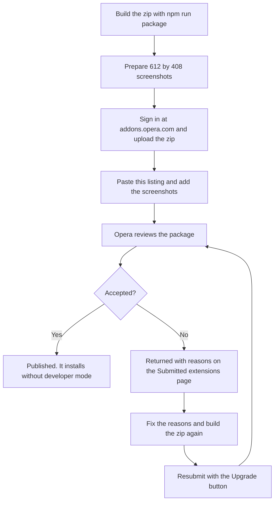

# Store listing

Paste these fields into the Opera add-ons form. Build the zip with `npm run package`, then upload it.

Checked against the acceptance criteria (https://help.opera.com/en/extensions/acceptance-criteria/) and the publishing guidelines (https://help.opera.com/en/extensions/publishing-guidelines/) on 11 November 2026. The licence field below follows those guidelines as of 16 November 2026.

## Name

Workspace Tab Organiser

## Version

0.10.0

This is the `version` in `extension/manifest.json` and in `package.json`. Keep the three the same.

## Support page

https://github.com/andrewgepearce/workspace-tab-organiser

The README on that page is the support page. It has to stay about this extension.

## Category

Productivity

## Licence

MIT. The text is in `LICENSE` at the root of the repository.

In the store's licence field, choose MIT, or paste the MIT text as the end user licence agreement. If the field is left empty, Opera's publishing guidelines license the content to end users under CC BY-NC-ND 4.0 instead.

## Summary

Workspace Tab Organiser groups the tabs in your current workspace by your own site rules, and previews every move before it happens.

The same sentence is `description` in `extension/manifest.json`. It is 132 characters. The manifest limit is 132. It does not contain Opera.

## Description

This is for people who keep many tabs open across Opera workspaces and want them tidied by site, without doing it by hand.

Workspace Tab Organiser arranges the tabs in the current workspace.

You keep an ordered list of rules. Each rule is a hostname and a path prefix. Rules are tried from top to bottom and the first match wins. Tabs that match none of the rules can form an automatic group when at least two tabs in that workspace share a hostname and the first path segment. A single unmatched tab stays on its own and is sorted by its title. A tab that is not a normal web page is left out of the groups.

The toolbar button opens a popup for the current workspace only. Other workspaces are not listed and are not moved. The heading is the workspace name. Under it is a summary of how many tabs would move. Each group is a card with its name, a Rule or Automatic tag, the tab count and the tab titles. Unmatched tabs and non-web tabs sit in collapsed lists. A single unmatched tab, and each Automatic card, has an Add rule button. Add rule saves a rule on this computer and refreshes the preview. Nothing moves until Apply. Apply then shows a short result: how many tabs moved, how many were already in place, and whether anything failed. Cancel closes the popup and leaves the tabs where they are.

The Options page is a list of one-line rules. Add a rule from a URL, drag a row to change the order, and press Save. A checkbox, Group unmatched tabs automatically, turns those groups on or off. It is on by default.

Rules, tab titles and tab addresses stay in this browser. They are not sent anywhere.

## Testing

Tested on macOS in Opera 139. Opera's publishing guidelines also recommend a check on Windows.

## Single purpose

The only purpose is to arrange tabs in the current workspace into ordered groups. The toolbar button opens that preview. It does not add a second tool.

## Permissions

| Permission | Why it is needed |
| --- | --- |
| storage | Saves the ordered rules and the automatic-groups setting on this computer. |
| tabs | Reads tab addresses and titles in the current window, and moves tabs when you press Apply. |

No host permission is requested. The extension does not ask to write workspaces or to create native tab groups.

## Privacy

No data leaves the browser. There is no analytics. There is no remote code. The package has no background page and does not call a website. Rules are stored with `chrome.storage.local`.

## Self-assessment

| Criterion | Assessment |
| --- | --- |
| One clear purpose | The extension only arranges tabs in the current workspace. The toolbar button opens that preview. |
| No Opera in the name | The name, the popup title, the Options title and the summary do not contain Opera. The repository name is unchanged and is not the store name. |
| No external JavaScript | Every script is a local module in the package. No script is loaded from a site. |
| No minified or obfuscated first-party code | The scripts in the zip are the source files. Nothing is minified or obfuscated. |
| Valid manifest | Manifest V2. `npm run package` rejects an Opera name, a version that differs from package.json, a manifest version other than 2, a missing listed file, and a description that is empty or longer than 132 characters. |
| No obvious bugs | Node tests cover the rules, the preview and Apply. The preview, the rule rows, automatic groups, Apply and Add rule have been checked in Opera. Check the 0.10.0 name and icon in Opera before upload. |
| Popup sized for a popup | The popup is 360 pixels wide and at most 560 pixels tall. Titles are cut to one line. Apply and Cancel stay visible. The list scrolls vertically when the workspace has many tabs. There is no horizontal scrolling. |
| No unused files or redundant permissions | The zip leaves out `extension/dev`, which the popup and the Options page do not use. The only permissions are `storage` and `tabs`, and both are used. |
| Does what it says | This listing matches the popup and the Options page: ordered rules, automatic groups, sorting, Preview then Apply, the current workspace only, and Add rule from the popup. |

Also on those pages, and not contradicted by this package:

- The icons are the same artwork at 16, 48 and 128 pixels. They are not words on a coloured background. The PNG files are not interlaced.
- Screenshots should be 612 by 408 pixels. The guidelines say not to go above 800 by 600. The preferred size is 612 by 408, on a white background, with other extensions disabled.
- The summary is one sentence and says what the extension does. The description says who it is for, how to use it, and what the popup and the Options page look like.
- The extension does not send private data out, and it does not change referral parameters.

## Upload

1. From the repository, run `npm test` and `npm run package`.
2. The zip is `dist/workspace-tab-organiser-0.10.0.zip`. `unzip -l` should show `manifest.json` at the root and no `dev/` entry.
3. Sign in at https://addons.opera.com.
4. Open the Upload Extensions form and upload the zip. The guidelines describe a multi-page form. The last page is a review of the choices before you submit.
5. Set the name, version, support page, category, licence, summary and description from this file. Add the screenshots. The shot list is in [screenshots.md](screenshots.md).
6. Submit from the review page.
7. Follow the package on the Submitted extensions page.
8. If it is returned, the reasons are on that page. Fix them, build the zip again, and resubmit with the Upgrade button next to the package name.

If the summary, description or screenshots are not on the first upload page, open the new version and look for the General, Media and Translations tabs. Opera staff have pointed developers there before when those fields were not on the upload step itself.

## Submission flow

